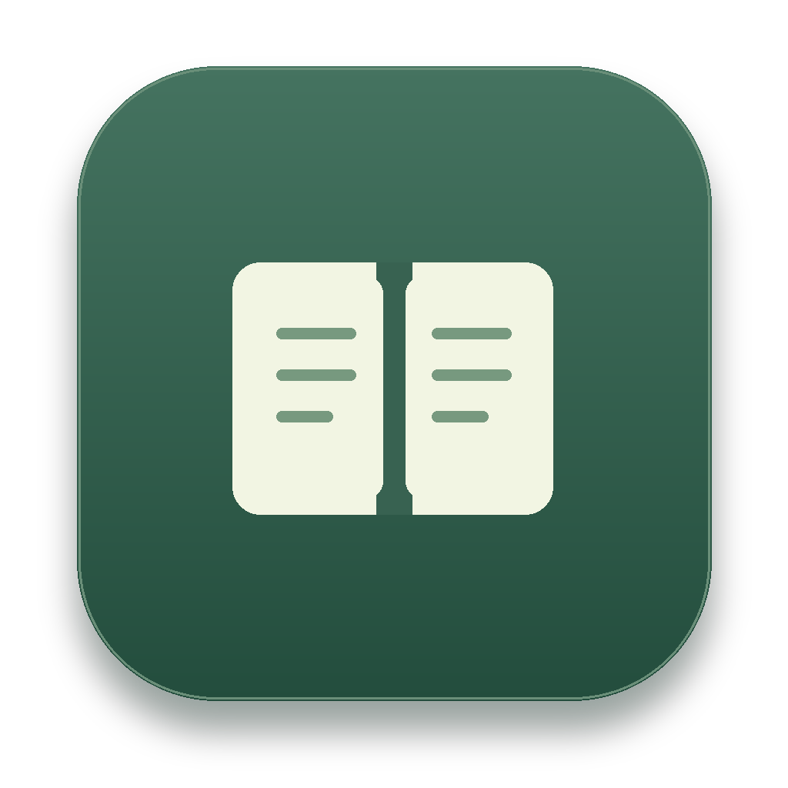
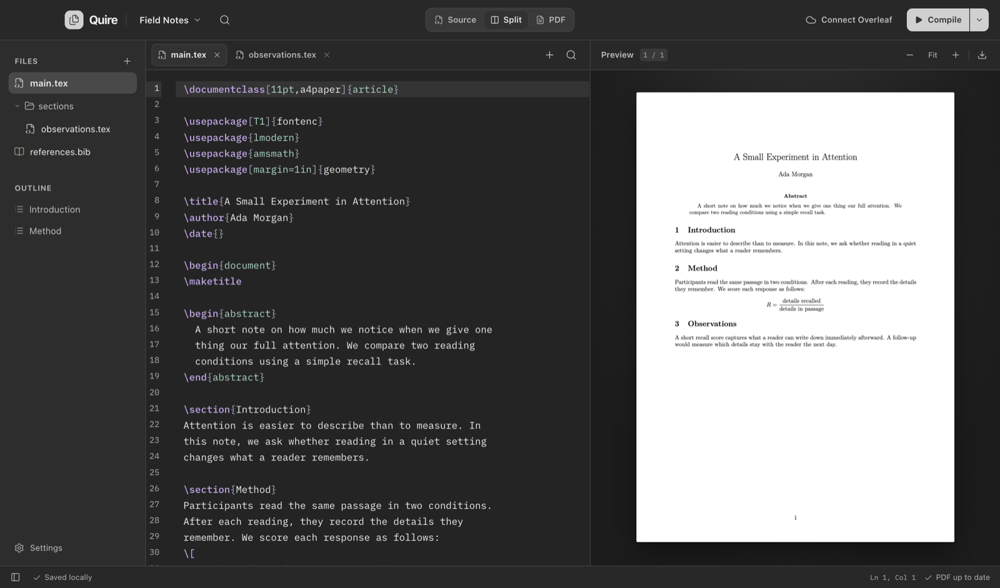
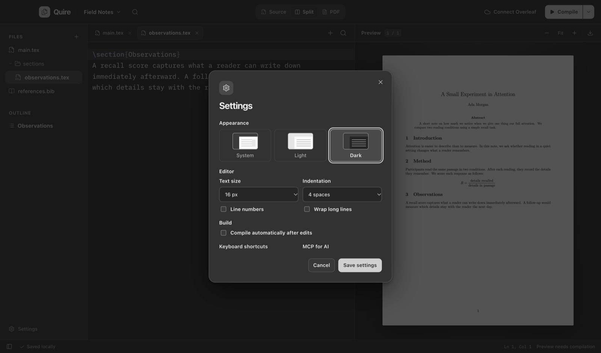

<p></p>

# Quire

A local-first LaTeX editor for macOS and Linux. Edit ordinary folders offline, preview your PDF beside the source, and sync changes back to the same Overleaf project when connected.

[Download Quire](https://github.com/WiaderekB/Quire/releases) · [User guide](docs/usage.md) · [What's new in 0.3.0](docs/releases/v0.3.0.md)



## Download

| Platform | Package |
| --- | --- |
| macOS, Apple Silicon and Intel | [Universal DMG](https://github.com/WiaderekB/Quire/releases/download/v0.3.0/Quire-0.3.0-mac-universal.dmg) |
| Linux, Intel and AMD | [x64 archive](https://github.com/WiaderekB/Quire/releases/download/v0.3.0/Quire-0.3.0-linux-x64.tar.gz) |
| Linux, 64-bit ARM | [ARM64 archive](https://github.com/WiaderekB/Quire/releases/download/v0.3.0/Quire-0.3.0-linux-arm64.tar.gz) |

On macOS, open the DMG and drag Quire into Applications. The 0.3.0 DMG is an ad hoc signed developer build. On Linux, extract the archive and run the `quire` executable.

Editing and autosave work offline. Install `latexmk` and the TeX packages your projects use to compile PDFs locally. Overleaf sync requires Git. [MacTeX](https://tug.org/mactex/) · [TeX Live](https://tug.org/texlive/)

## Work in Quire

- **Write.** Tabs retain undo history while you switch files. Use Quick Open with `⌘K` or `Ctrl+K` to find files and commands. Focus mode keeps the source in view.
- **Compile.** Choose pdfLaTeX, XeLaTeX, or LuaLaTeX. Turn on automatic compilation in Settings to refresh the PDF after a pause in typing. The last successful PDF stays visible if compilation fails.
- **Start a paper.** Use an article, lab report, or coursework template. Insert sections, equations, or tables with the plus button above the source.
- **Sync.** Use **Connect Overleaf** with a project URL and a Git token. Your edits save to disk first and sync back to the original project. Overleaf Cloud requires Git access on the project. Self-hosted Overleaf requires Server Pro with Git Bridge. [Overleaf Git integration](https://docs.overleaf.com/integrations-and-add-ons/git-integration-and-github-synchronization/git-integration) · [Server Pro Git Bridge](https://docs.overleaf.com/on-premises/configuration/overleaf-toolkit/server-pro-only-configuration/git-integration)
- **Connect an AI client.** Under **Settings → MCP for AI**, copy the local server configuration for a single project. The server requires Node.js 24 and provides read access by default. Enable source edits when you need them.

<details>
<summary>Appearance and editor settings</summary>



</details>

## Run from source

Install Node.js 24 and use the pnpm version pinned in `package.json`.

```sh
pnpm install --frozen-lockfile
pnpm start
```

Quire opens with an editable sample paper and a PDF. Run `pnpm build` and `pnpm test` to check changes locally. The integration tests use a disposable HTTPS Git remote and an MCP client. The Git test requires OpenSSL.

[User guide and shortcuts](docs/usage.md) · [Build and release guide](docs/releasing.md) · [Report a bug](https://github.com/WiaderekB/Quire/issues/new?template=bug-report.yml)
